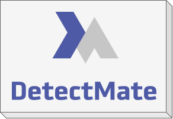

# DetectMate Service



DetectMate Service is a framework for building modular log processing and anomaly detection services that
communicate via [NNG](https://nng.nanomsg.org/) messaging. Each service runs one component (for example a
parser or detector from [DetectMateLibrary](https://github.com/ait-detectmate/DetectMateLibrary)), receives
data on an input socket, forwards the results to one or more output sockets, and exposes an HTTP API for
management and Prometheus metrics.

Full documentation: <https://ait-detectmate.github.io/DetectMateService/latest>

## Requirements

- Python 3.12 or newer
- [uv](https://github.com/astral-sh/uv) (recommended) or pip
- Docker and Docker Compose (optional, for containerized pipelines)

## Installation

```bash
git clone https://github.com/ait-detectmate/DetectMateService.git
cd DetectMateService
uv sync                 # or: pip install .
uv sync --extra full    # optional: all library component extras
```

See [Installation](https://ait-detectmate.github.io/DetectMateService/latest/installation/) for pip setup,
optional extras and Docker builds.

## Usage

```bash
touch settings.yaml
uv run detectmate --settings settings.yaml
```

- [Running the Service](https://ait-detectmate.github.io/DetectMateService/latest/usage/)
- [Configuration](https://ait-detectmate.github.io/DetectMateService/latest/configuration/)
- [Using a Library Component](https://ait-detectmate.github.io/DetectMateService/latest/library/)
- [Monitoring with Prometheus](https://ait-detectmate.github.io/DetectMateService/latest/prometheus/)

## Docker Compose

```bash
docker compose up
```

See the [Docker Compose Reference](https://ait-detectmate.github.io/DetectMateService/latest/docker-compose/).

## Tutorial

[Detecting Anomalies in Nginx Logs](https://ait-detectmate.github.io/DetectMateService/latest/tutorial/) —
an end-to-end walkthrough from a fresh machine to a running pipeline.

## Related Projects

- [DetectMateLibrary](https://github.com/ait-detectmate/DetectMateLibrary)
  ([docs](https://ait-detectmate.github.io/DetectMateLibrary/latest/))

## Contribution

We're happily taking patches and other contributions. Please see the following links for how to get started:

- [Git Workflow](https://ait-detectmate.github.io/DetectMateService/latest/contribution/)
- [Development](https://ait-detectmate.github.io/DetectMateService/latest/development/)

If you encounter any bugs, please create an issue on [GitHub](https://github.com/ait-detectmate/DetectMateService/issues).

## License

[EUPL-1.2](https://github.com/ait-detectmate/DetectMateService/blob/main/LICENSE.md)
